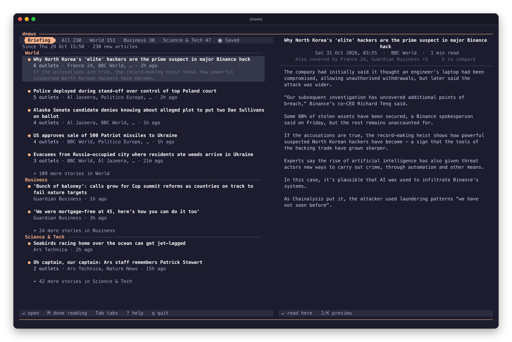

# dnews

A terminal news reader. It reads your RSS feeds, groups articles about the same event into
stories, and shows any article as clean, readable text.



- **Briefing:** the last two days as stories, not headlines. An event covered by eight outlets is
  one row, so the important news stands out. Press `M` when you are done and the next Briefing
  shows only what is new.
- **Reader:** articles without the website around them, with headings, quotes, lists and links.
- **One file to configure:** your feeds live in an OPML file; each folder is a tab.

Coverage in different languages joins the same story when it names the same people or places.
Grouping is plain statistics on titles and summaries, so it needs no account or API key.

## Install

You need the [Rust toolchain](https://rustup.rs). On Windows also a C compiler for the bundled
SQLite (Visual Studio Build Tools with "Desktop development with C++").

```bash
git clone https://github.com/ret3030/dnews
cd dnews
./install.sh          # Windows: .\install.ps1
```

The installer builds dnews, puts it in the folder below, and copies an example feed list to your
config folder if you have none yet. Make sure the binary folder is on your `PATH`, then run `dnews`.

| | Binary | Feed list | Database |
|---|---|---|---|
| macOS | `~/.local/bin/dnews` | `~/Library/Application Support/dnews/feeds.opml` | `~/Library/Application Support/dnews/dnews.db` |
| Linux | `~/.local/bin/dnews` | `~/.config/dnews/feeds.opml` | `~/.local/share/dnews/dnews.db` |
| Windows | `%LOCALAPPDATA%\Programs\dnews\dnews.exe` | `%APPDATA%\dnews\feeds.opml` | `%APPDATA%\dnews\data\dnews.db` |

The tabs look best with a [Nerd Font](https://www.nerdfonts.com); without one, narrow terminals get
plain text tabs.

## Feeds

Edit `feeds.opml` and restart dnews. Each folder becomes a tab; each `outline` with an `xmlUrl` is
a feed. Most feed readers can export this format, so you can bring your existing list.

```xml
<opml version="2.0">
  <body>
    <outline text="World">
      <outline text="BBC World" priority="high" xmlUrl="https://feeds.bbci.co.uk/news/world/rss.xml"/>
      <outline text="Al Jazeera" xmlUrl="https://www.aljazeera.com/xml/rss/all.xml"/>
    </outline>
    <outline text="Tech">
      <outline text="Hacker News" priority="low" xmlUrl="https://news.ycombinator.com/rss"/>
    </outline>
  </body>
</opml>
```

`priority="high"` or `"low"` tells the Briefing which outlets to trust more when ranking stories.
Feeds that fail to load are listed under `!`.

## Keys

Press `?` in dnews for this list.

| Briefing | |
|---|---|
| `Enter` | expand a story, read an article |
| `M` | done reading: mark it all read |
| `b` | in an article: back to its story |

| List | |
|---|---|
| `j` `k` / `g` `G` / `d` `u` | move / top, bottom / page |
| `Enter` | read the article |
| `Tab` `Shift+Tab` | next, previous tab |
| `/` | search titles |
| `c` | compact list |
| `M` | mark everything listed as read |
| `Ctrl+R` | reload feeds |
| `q` | quit |

| Article | |
|---|---|
| `j` `k` / `d` `u` `Space` / `g` `G` | scroll / page / top, end |
| `J` `K` | next, previous article |
| `1` `2` … `Enter` | open link `[n]` |
| `w` | wide or narrow text |
| `q` `Esc` | back to the list |

| Anywhere | |
|---|---|
| `s` | save for later (the Saved tab keeps it forever) |
| `m` | toggle read |
| `o` / `y` | open in the browser / copy the link |

On a terminal at least 150 columns wide the article opens next to the list: `Enter` reads it there,
`q` returns to the list, and `Shift+J` `Shift+K` preview the next and previous article.

## Data

Articles are kept in a local SQLite database. Unsaved articles older than 60 days, or from a folder
you removed from the feed list, are deleted automatically. The database is backed up to
`dnews.db.bak` on every start.

## Development

```bash
cargo test                   # offline tests, including clustering on real news in testdata/
cargo test -- --ignored      # tests that fetch real feeds and articles
cargo clippy --all-targets
```

## License

[MIT](LICENSE). If dnews is useful to you, you can [buy me a coffee](https://buymeacoffee.com/ret3030).
